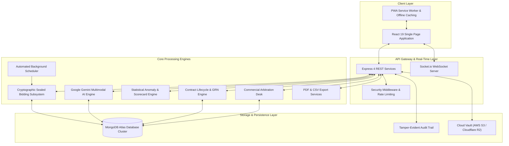
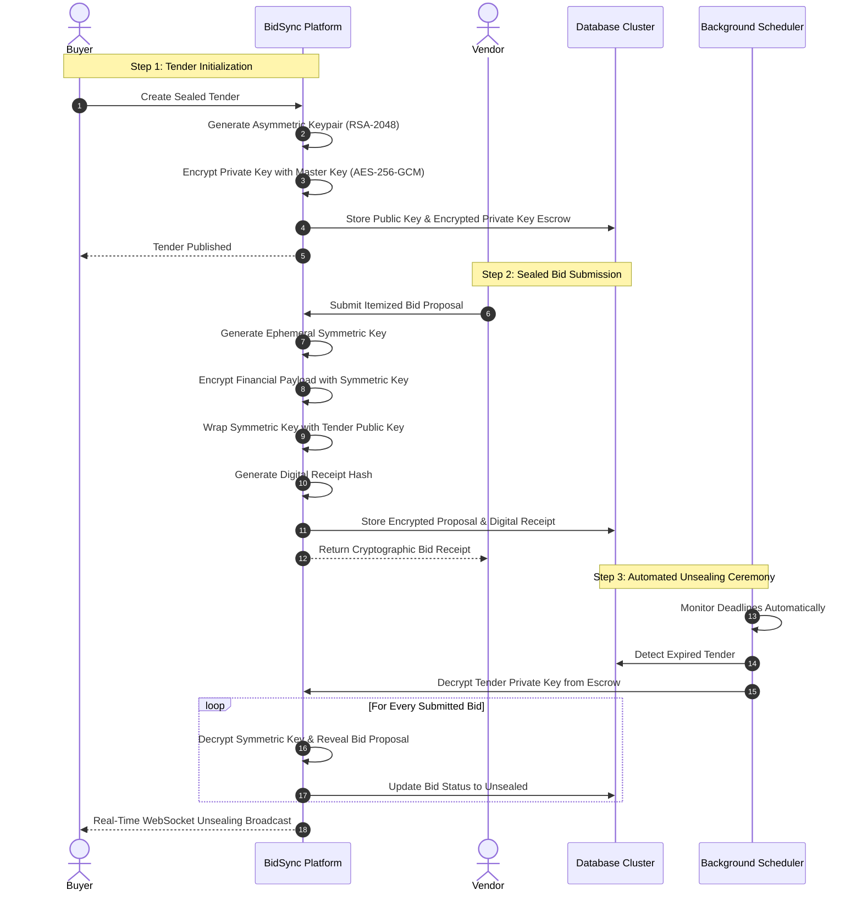
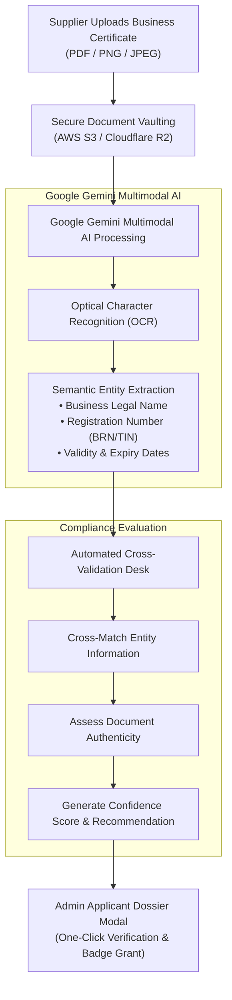
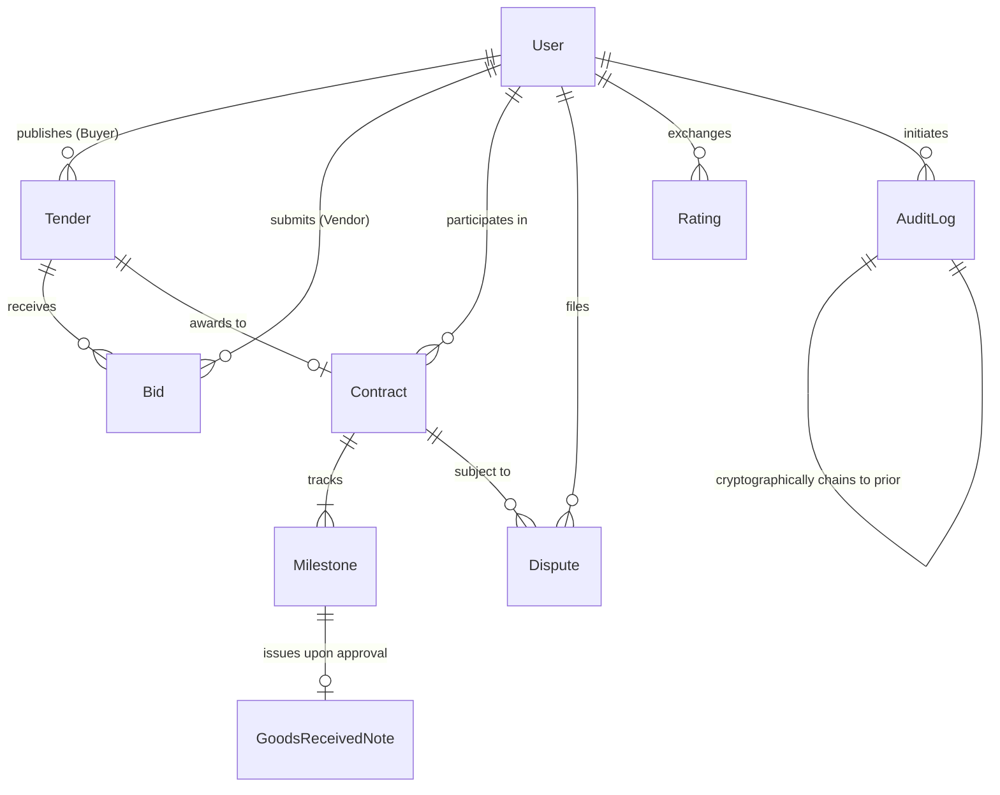

# 📐 BidSync: Technical Architecture Overview

This document presents the high-level system architecture, core design patterns, and technologies powering the [BidSync Platform](https://bidsync.online).

---

## 📑 Architecture Contents

1. [High-Level System Topology](#1-high-level-system-topology)
2. [Cryptographic Sealed Bidding Subsystem](#2-cryptographic-sealed-bidding-subsystem)
3. [Google Gemini Multimodal AI KYC Engine](#3-google-gemini-multimodal-ai-kyc-engine)
4. [Statistical Evaluation & Anomaly Detection Model](#4-statistical-evaluation--anomaly-detection-model)
5. [Real-Time WebSocket Architecture](#5-real-time-websocket-architecture)
6. [Tamper-Evident Audit Ledger](#6-tamper-evident-audit-ledger)
7. [Data Architecture & Schemas](#7-data-architecture--schemas)

---

## 1. High-Level System Topology

BidSync is architected as a modern, multi-tier web application designed for high availability, security, and responsive real-time interactions:

---

## 2. Cryptographic Sealed Bidding Subsystem

To eliminate bid leakage and favoritism, BidSync implements **Zero-Knowledge Envelope Encryption**. Submitted tender bids remain cryptographically sealed until the tender closing deadline expires.

### Key Lifecycle & Sealing Flow

### Security Highlights
- **Zero-Knowledge Privacy:** Unsealed figures cannot be inspected in plaintext while tenders are active.
- **Automated Unsealing Ceremony:** Timed background cron workers unseal all bids simultaneously upon deadline expiration.
- **Digital Non-Repudiation Receipts:** Vendors receive cryptographic hash receipts confirming exact submission integrity.

---

## 3. Google Gemini Multimodal AI KYC Engine

BidSync integrates Google Gemini Multimodal AI models via `@google/generative-ai` to automate supplier verification and eliminate fraud:

---

## 4. Statistical Evaluation & Anomaly Detection Model

Upon unsealing, BidSync's analytical engine processes bids through objective statistical models:

- **Predatory Dumping Detection:** Evaluates bids relative to group distributions to flag suspiciously low offers that risk project abandonment or substandard materials.
- **Budget Overrun Flagging:** Automatically detects bids exceeding client budget thresholds.
- **Collusive Pricing Alerts:** Identifies statistically identical bids across independent suppliers to protect against cartel pricing.
- **Composite Vendor Scorecard:** Balances Commercial Price, Technical Compliance, Delivery Timeline, and Verified KYC Reliability to identify the **Rank #1 Best Value** proposal.

---

## 5. Real-Time WebSocket Architecture

Powered by **Socket.io 4**, BidSync provides zero-latency updates across isolated channel rooms:

- **Tender Rooms (`tender:{id}`):** Delivers live ticking countdown clocks, anonymous bid count increments, unsealing alerts, and pre-bid clarification Q&A sync.
- **User Rooms (`user:{id}`):** Dispatches private alerts for contract awards, delivery submissions, and verification updates.
- **Automatic Reconnection:** Built-in connection lifecycle management ensures resilient synchronization across fluctuating mobile networks.

---

## 6. Tamper-Evident Audit Ledger

BidSync incorporates a blockchain-inspired SHA-256 hash-chained audit ledger:
- Each administrative and procurement action links cryptographically to the hash of the preceding record.
- Any manual database tampering or record alteration immediately breaks the hash chain.
- Administrators can execute mathematical ledger integrity checks directly from the governance dashboard.

---

## 7. Data Architecture & Schemas

The database structure in MongoDB Atlas supports the end-to-end procurement lifecycle:

---

  <strong>BidSync Technical Architecture Overview</strong> 
  Authored by Monith Kumarasinghe • <a href="https://bidsync.online">bidsync.online</a>

