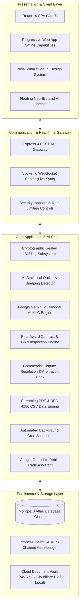

# 🏛️ BidSync: System Architecture, Capabilities & Visual Overview

<p align="center">
  
</p>

<p align="center">
  <a href="https://bidsync.online"></a>
  <a href="https://github.com/monithishanka/BidSync"></a>
  
  
  
  
</p>

<p align="center">
  <strong>The Official Architecture & Platform Overview for BidSync</strong><br/>
  An institutional-grade micro-procurement and sealed-bidding platform engineered to eliminate bid leakage, procedural favoritism, predatory dumping, and procurement corruption.
</p>

---

## 📌 Repository Purpose

This repository provides a high-level **system overview, architectural blueprint, capabilities summary, and visual previews** for the [BidSync Platform](https://bidsync.online).

It presents the architectural concepts, technologies used, operational workflows, and security principles behind BidSync while preserving proprietary implementation details.

---

## 📑 Overview Index

| Document | Description |
|---|---|
| 📐 [**ARCHITECTURE.md**](ARCHITECTURE.md) | High-level system topology, technology layers, cryptographic models, and data organization. |
| 🚀 [**FEATURES.md**](FEATURES.md) | Overview of platform features, capabilities, and the business value delivered to buyers and suppliers. |
| 🔄 [**WORKFLOWS.md**](WORKFLOWS.md) | Visual procurement lifecycle diagrams from tender drafting to contract completion and dispute arbitration. |
| 🛡️ [**SECURITY_AND_COMPLIANCE.md**](SECURITY_AND_COMPLIANCE.md) | Security principles, zero-knowledge envelope encryption, access controls, and audit integrity. |

---

## 🏛️ Executive Summary: The Procurement Problem

Traditional corporate and public-sector procurement processes face four pervasive challenges:

```
┌────────────────────────────────────────────────────────────────────────┐
│                   Traditional Procurement Vulnerabilities              │
├──────────────────────────┬─────────────────────────────────────────────┤
│ 1. Bid Leakage           │ Insiders inspect submitted bids and leak    │
│    & Favoritism          │ pricing to favored vendors before deadline. │
├──────────────────────────┼─────────────────────────────────────────────┤
│ 2. Predatory Dumping     │ Substandard contractors submit unrealisti-  │
│    & Quality Risk        │ cally low bids to win, later defaulting.    │
├──────────────────────────┼─────────────────────────────────────────────┤
│ 3. Manual BOQ Overhead   │ Comparing multi-item line prices and taxes  │
│    & Evaluation Delays   │ across suppliers takes days of manual work. │
├──────────────────────────┼─────────────────────────────────────────────┤
│ 4. Lack of Verifiable    │ Standard database logs can be modified      │
│    Auditability          │ without verifiable mathematical detection.  │
└──────────────────────────┴─────────────────────────────────────────────┘
```

### How BidSync Solves This

1. **Zero-Knowledge Cryptographic Sealed Bidding:** Financial proposals are protected via asymmetric envelope encryption. Neither buyers, competitors, nor system administrators can inspect bid prices until the tender deadline officially expires.
2. **AI Statistical Anomaly & Dumping Detector:** Automated statistical models evaluate bids upon unsealing to detect predatory dumping, budget overruns, and collusive price collisions.
3. **Google Gemini Multimodal AI KYC:** Intelligent multimodal OCR and semantic extraction automatically inspect business registration certificates, cross-verifying entity identities and scoring fraud risks with non-blocking registration.
4. **Post-Award Fulfillment & Goods Received Notes (GRN):** Full lifecycle management with performance milestones, delivery tracking, physical inspection logs, and verifiable GRN certificates.
5. **Tamper-Evident Hash-Chained Audit Ledger:** Blockchain-inspired cryptographic chaining ensures any unauthorized log alterations are mathematically detected.
6. **Google Gemini AI Public Trade Assistant:** Prospective suppliers and guests explore active public tenders and platform policies 24/7 without authentication, backed by strict zero-secret leakage sanitization and offline fallback parsing.
7. **Applicant Governance & Supplier Re-Approval Desk:** Multi-state applicant lifecycle tracking (`pending`, `approved`, `rejected`), documented rejection reasons, reactive `pendingApprovals` badge updates, and on-demand supplier restoration.

---

## 📐 High-Level System Architecture



---

## ⚡ Procurement Lifecycle Overview

```mermaid
flowchart LR
    A["1. Tender Creation\n(Smart Templates + BOQ)"] --> B["2. Sealed Bidding\n(Envelope Encryption)"]
    B --> C["3. Deadline Expiry\n(Automated Unsealing)"]
    C --> D["4. AI Evaluation\n(Anomaly Detection & Scorecard)"]
    D --> E["5. Contract Award\n(Milestone Instantiation)"]
    E --> F["6. Goods Received Note\n(Inspection & GRN Sign-off)"]
    F --> G["7. Rating & Feedback\n(Credibility Update)"]

    style A fill:#FEF08A,stroke:#000,stroke-width:2px
    style B fill:#BAE6FD,stroke:#000,stroke-width:2px
    style C fill:#FED7AA,stroke:#000,stroke-width:2px
    style D fill:#E9D5FF,stroke:#000,stroke-width:2px
    style E fill:#BBF7D0,stroke:#000,stroke-width:2px
    style F fill:#A7F3D0,stroke:#000,stroke-width:2px
    style G fill:#FBCFE8,stroke:#000,stroke-width:2px
```



---

## 📸 Visual UI Preview & Showcase

<p align="center">
  <strong>Home Page & Institutional Hero</strong><br/>
  
</p>

<p align="center">
  <strong>Active Tenders & Real-Time Filtering</strong><br/>
  
</p>

<p align="center">
  <strong>Secure User Authentication & Onboarding</strong><br/>
  
</p>

---

## 🛠️ Technology Stack (What We Use)

| Layer | Technologies Used | Purpose |
|---|---|---|
| **Frontend Framework** | **React 19** + **Vite 7** | Modern responsive single-page application |
| **Styling & UI** | **Neo-Brutalism Design** | High-contrast, institutional visual language |
| **Progressive Web App**| **Service Workers & Manifest** | Standalone installation and offline view caching |
| **Backend Runtime** | **Node.js** + **Express 4** | High-concurrency RESTful API architecture |
| **Real-Time Engine** | **Socket.io 4** | Live auction countdowns, bid counters, and instant notifications |
| **AI Document KYC** | **Google Gemini Multimodal Flash** | Automated OCR and legal entity verification on KYC certificates |
| **AI Public Trade Assistant** | **Google Gemini API** | 24/7 public tender inquiry support with zero secret leakage |
| **Database** | **MongoDB Atlas** + **Mongoose 8** | Flexible document storage with atomic sequence numbering |
| **Cryptography** | **Node.js native `crypto`** | RSA-2048 and AES-256 envelope encryption, SHA-256 non-repudiation |
| **Audit Ledger** | **SHA-256 Hash Chaining** | Tamper-evident administrative compliance logging |
| **Cloud Storage** | **AWS S3 / Cloudflare R2** | Secure cloud storage for tender specifications and KYC files |
| **Document Export** | **PDFKit & CSV Engine** | Streaming vector PDF statements and RFC 4180 CSV exports |
| **Email Delivery Engine** | **Resend REST API (HTTPS) + Nodemailer** | High-reliability email delivery with automatic test-mode fallback |
| **Background Cron** | **`node-cron`** | Automated tender unsealing ceremonies and state transitions |
| **Automated Testing** | **Vitest 5 + Supertest 7** | 49 passing automated unit and integration tests across 10 suites |

---

## 👤 Founder & Leadership

<p align="center">
  <strong>Monith Kumarasinghe</strong><br/>
  Founder & Lead Software Engineer, BidSync
</p>

<p align="center">
  <em>"I founded and built BidSync from the ground up with one clear goal: to eradicate bid leakage, procedural favoritism, and corruption through transparent, cryptographically secure procurement architectures."</em>
</p>

<p align="center">
  <a href="https://linkedin.com/in/monithishanka"></a>
  <a href="https://x.com/monithishanka"></a>
  <a href="https://github.com/monithishanka"></a>
  <a href="https://bidsync.online"></a>
</p>

---

## 📄 License & Attribution

This documentation and architectural overview is licensed under the [MIT License](LICENSE).  
Copyright © 2026 Monith Kumarasinghe. All rights reserved.
