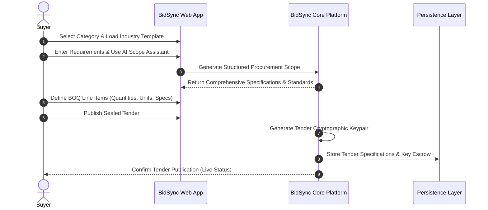
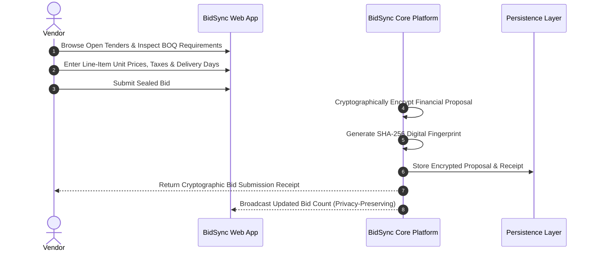
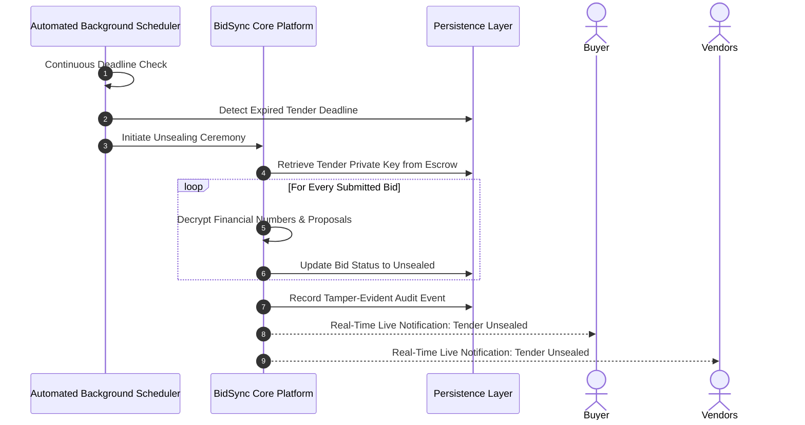
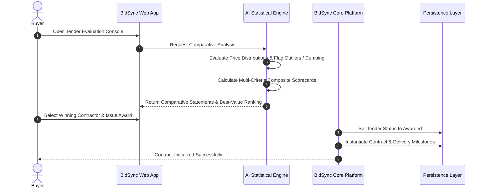
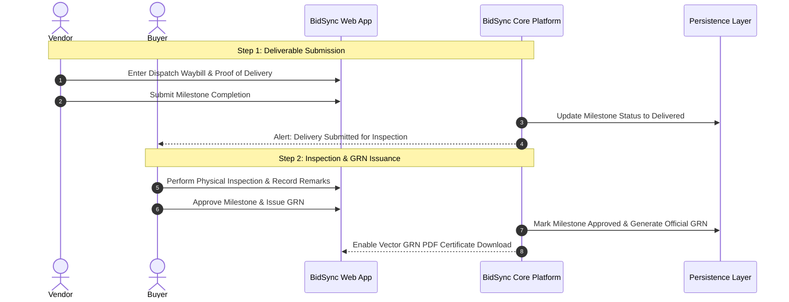
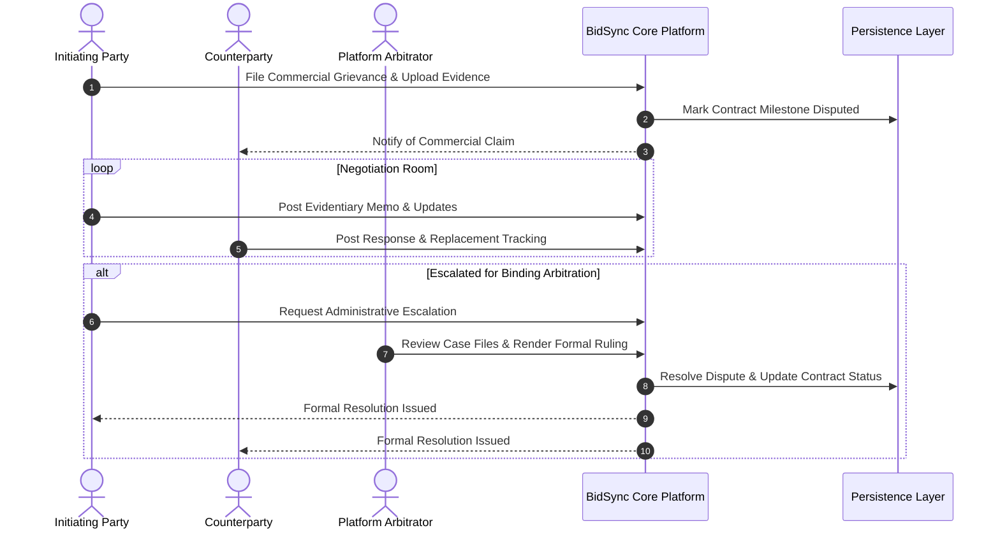
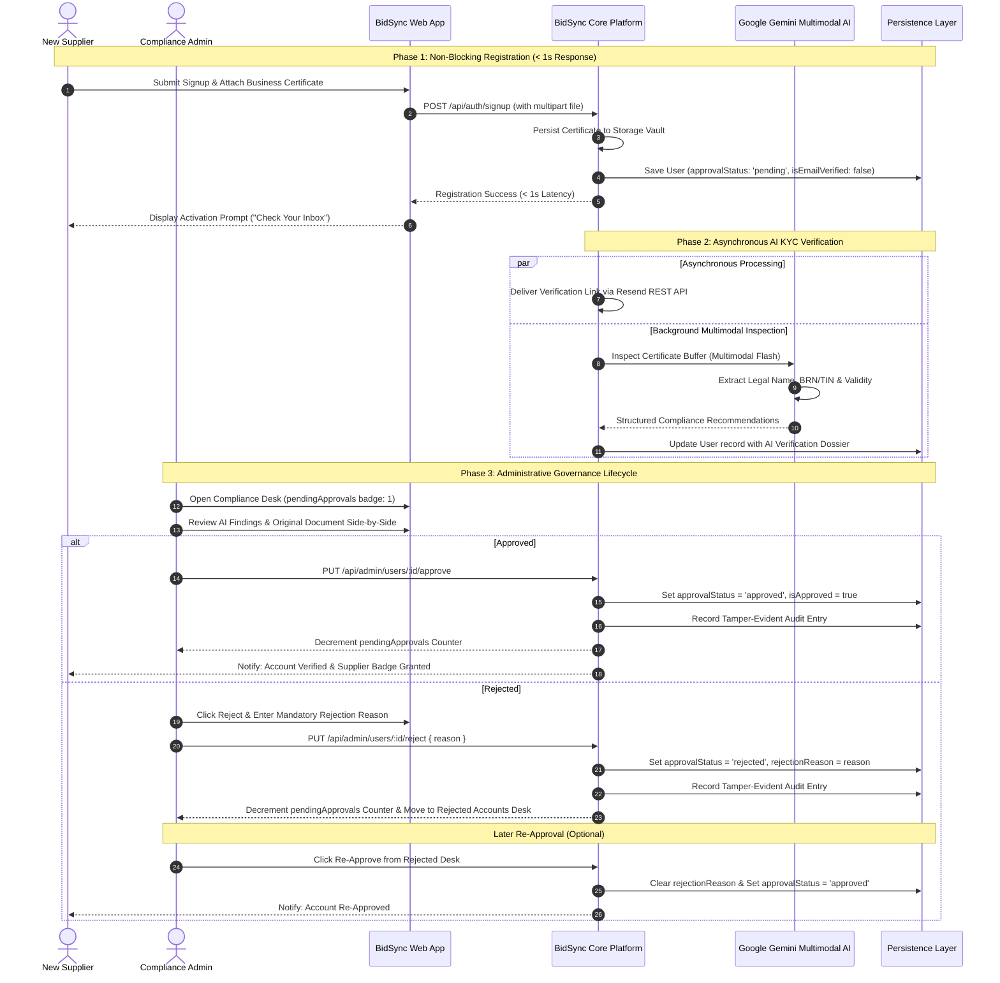
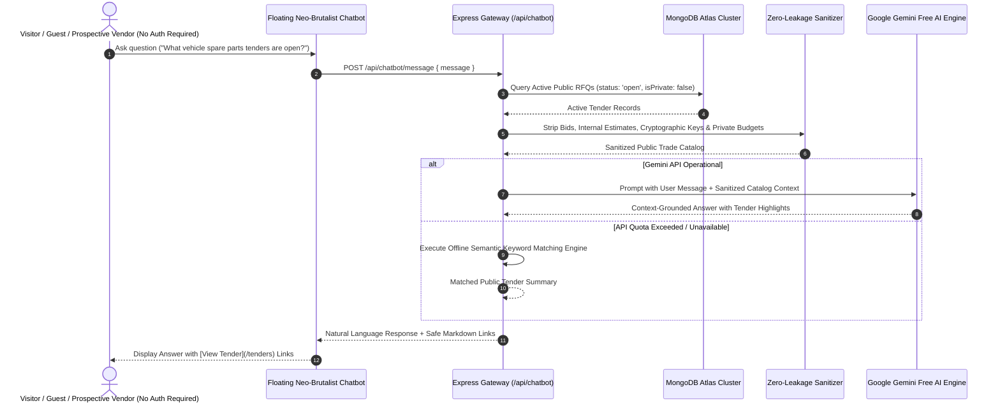

# 🔄 BidSync: Procurement Workflows & Lifecycle Diagrams

This document illustrates the operational workflows governing the procurement lifecycle on the [BidSync Platform](https://bidsync.online).

---

## 📑 Workflow Index

1. [Workflow 1: Tender Creation & BOQ Definition](#workflow-1-tender-creation--boq-definition)
2. [Workflow 2: Sealed Bid Submission](#workflow-2-sealed-bid-submission)
3. [Workflow 3: Automated Tender Unsealing Ceremony](#workflow-3-automated-tender-unsealing-ceremony)
4. [Workflow 4: AI Comparative Evaluation & Award](#workflow-4-ai-comparative-evaluation--award)
5. [Workflow 5: Delivery & Goods Received Notes (GRN)](#workflow-5-delivery--goods-received-notes-grn)
6. [Workflow 6: Commercial Dispute Resolution](#workflow-6-commercial-dispute-resolution)
7. [Workflow 7: Supplier Onboarding & AI KYC Verification](#workflow-7-supplier-onboarding--ai-kyc-verification)
8. [Workflow 8: Public AI Support & Trade Inquiries (Zero-Leakage)](#workflow-8-public-ai-support--trade-inquiries-zero-leakage)

---

### Workflow 1: Tender Creation & BOQ Definition

---

### Workflow 2: Sealed Bid Submission

---

### Workflow 3: Automated Tender Unsealing Ceremony

---

### Workflow 4: AI Comparative Evaluation & Award

---

### Workflow 5: Delivery & Goods Received Notes (GRN)

---

### Workflow 6: Commercial Dispute Resolution

---

### Workflow 7: Supplier Onboarding, AI KYC & Administrative Governance

---

### Workflow 8: Public AI Support & Trade Inquiries (Zero-Leakage)

---

  <strong>BidSync Procurement Workflows & Lifecycle Diagrams</strong> 
  Authored by Monith Kumarasinghe • <a href="https://bidsync.online">bidsync.online</a>

